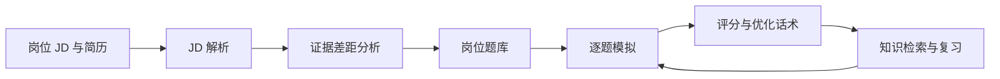

# 求职面试备考 Agent

[](https://github.com/Yeluo-XH/interview-prep-agent/actions/workflows/tests.yml)


基于 **DeepSeek Harness** 的本地 Agent Bundle，将 JD 解析、简历证据差距识别、题库生成、逐题模拟、回答评分和复习组织成完整工作流。

**项目入口：** [实现说明](docs/ARCHITECTURE.md) · [虚构示例](examples) · [自动测试](https://github.com/Yeluo-XH/interview-prep-agent/actions) · [版本记录](CHANGELOG.md)

## 一分钟查看可运行演示

安装 Python 3.10 或更高版本后，无需第三方依赖、账户和 API Key：

```powershell
git clone https://github.com/Yeluo-XH/interview-prep-agent.git
cd interview-prep-agent
python scripts/demo.py
python -m unittest discover -s tests -v
```

演示使用虚构材料和预设人工评分，通过真实 CLI 验证数据链路，输出：

```text
PASS: JD -> gaps -> questions -> answer -> pause -> skip -> finish
Score: 78.75 / 100; scored: 1; skipped: 1
```

需要保留示例状态时运行 `python scripts/demo.py --output demo-output`。完整的模型面试体验按下方步骤安装到 Harness。

## 能做什么

1. 拆解岗位要求，保留 JD 原文证据与稳定需求 ID。
2. 对照简历区分「证据充分、证据不足、未提及、已确认差距」。
3. 生成与岗位要求关联的题库，支持逐题教学与考试模式。
4. 按五个维度反馈回答，给出不足、优化话术和针对性追问。
5. 保存本地会话、重答历史、跳过状态与复习记录。
6. 使用 Harness 原生麦克风转写流程，并通过 Windows 本地语音朗读题目。



## 环境与安装

- 当前验证版本：DeepSeek Harness **0.2.2-rc.1**，Windows。
- 模型推理由 Harness 已配置的模型账户完成；Python 脚本仅用标准库。
- 本仓库是 Harness 扩展，需要先安装 Harness；不是独立网站或独立大模型。

下载或克隆本仓库，在 Harness 的创造模式（Creator / cordis）中发送以下内容，将路径替换为实际文件夹：

```text
请使用 plugin_manager 安装本地 Bundle，target 为本仓库文件夹的绝对路径。
安装后检查 list_bundles 和 list_plugins，确认 preset-interview-prep 激活。
```

若使用工具参数：`{"action":"install_bundle","target":"<仓库绝对路径>"}`。
批准对应安装操作后，若提示 restart-required，重启 Harness。新建聊天，选择「求职面试备考」。现有会话保留原预设。

## 使用示例

```text
请先拆解以下 JD，再对照简历分析证据差距，生成 12 题题库。
然后进行 5 题教学模式模拟，一次只问一题，我回答后再评分。
JD：……
简历：……
```

常用指令：开始语音模拟、切换考试模式、跳过这题、暂停并保存、继续上次练习、结束并生成复习计划、检索数据库索引知识点。

首次语音使用需要在 Harness 插件页启用「语音输入」，准备语音模型，手动授权麦克风；停止后校对转写并发送。朗读由 `scripts/speak.ps1` 调用系统中文声音。系统禁止脚本时先取得用户当次批准，再临时放行该进程；不修改系统全局策略。当前是逐轮语音，评分依据文字，未实现实时全双工或声学评分。

## 五个 Skill

| Skill | 职责 |
|---|---|
| interview-jd | 岗位要求与证据矩阵 |
| interview-resume-gap | 简历证据差距与补强动作 |
| interview-questions | 分层出题、逐题模拟与评分 |
| interview-voice | 转写操作、朗读与文字回退 |
| interview-knowledge | 本地知识卡与权威资料检索 |

## 评分与状态

模型依据回答内容为正确性、相关性、深度、证据、结构五个维度给出 0–4 分与理由，Python 按 **35 / 20 / 20 / 15 / 10** 的权重计算百分制分数。分数用于练习反馈；未经统计效度验证，不代表录用概率。

会话保存在当前工作区 `interview-data/<session-id>/state.json`。同题重答保留历史，均分仅统计每题最新有效回答，跳过题不计入均分。脚本实现原子写入、写锁、路径与引用校验。知识检索是关键词匹配与本地知识卡，不是向量数据库 RAG；联网能力取决于 Harness 配置的后端。

## 本地验证

```powershell
python -m unittest discover -s tests -v
python scripts/interview_store.py search --query "数据库 索引"
python scripts/interview_store.py --root interview-data init --title "后端工程师"
```

已通过 8 项单元测试，以及当前安装中预设挂载和五个 Skill 实际加载检查。Windows 中文声音可用性检查通过。真实 JD/简历模型效果、麦克风转写、联网后端与音频播放仍需使用者端到端验收。仓库提供 GitHub Actions 测试配置，推送后可在 Actions 查看结果。

Actions 在 Windows 与 Linux、Python 3.10 与 3.12 上执行单元测试和 CLI 演示，运行结果以页面状态为准。当前 Agent 的完整安装验证环境为 Windows。

## 目录

```text
cordis.patch.yml        Agent 预设与工具组合
skills/                 五个面试 Skill
scripts/interview_store.py  会话、评分与知识检索
scripts/speak.ps1       Windows 本地朗读
knowledge/core.json    常见技术知识卡
tests/test_store.py    8 项单元测试
scripts/demo.py        无模型调用的虚构数据演示
examples/              JD、差距、题目与评分示例
docs/ARCHITECTURE.md   数据模型、实现与验证边界
```

本项目在 AI 辅助下完成设计、实现与验证。简历与练习记录默认不入库；请仅使用虚构或脱敏材料作为公开示例。模型分析仍经由 Harness 配置的模型服务，扩展不收集 API Key。
